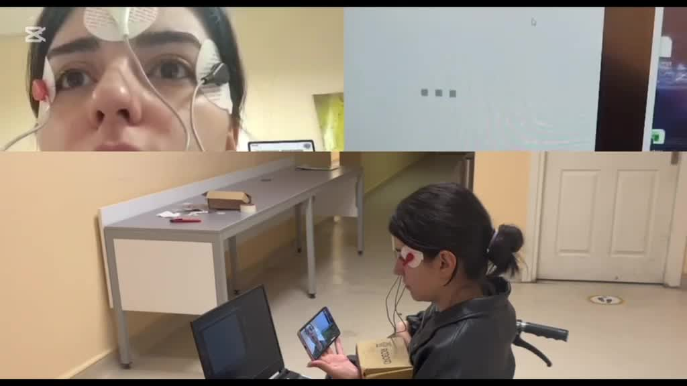
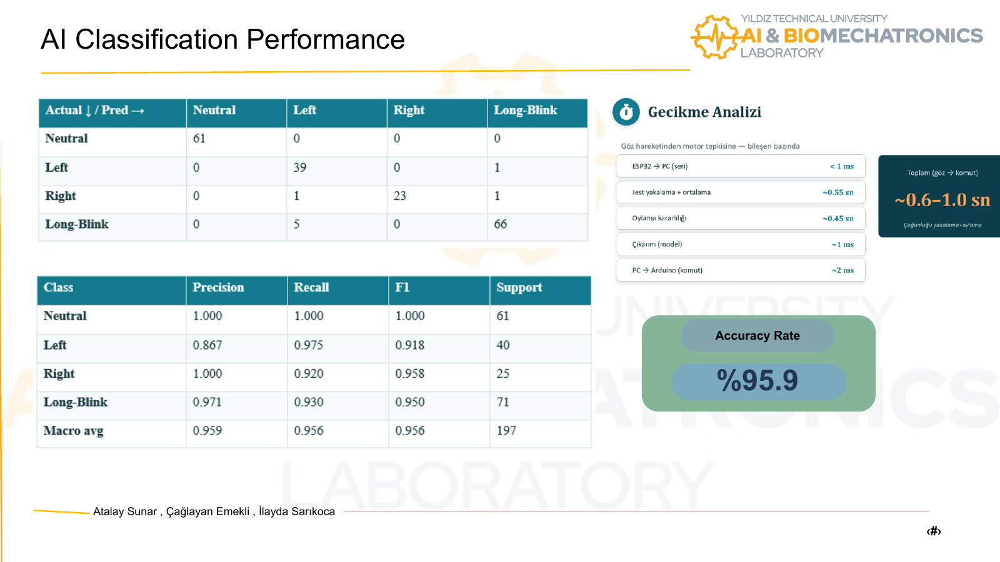

# EOG AI Wheelchair

**Eye-movement classification and command generation for an AI-assisted smart wheelchair prototype.**

Developed as a 2025-2026 Mechatronics Engineering graduation project at Yıldız Technical University, advised by Prof. Dr. Erhan Akdoğan. Python processes electrooculography (EOG) signals, recognizes **neutral, right, left and long blink**, and optionally sends commands to a separate motor-control Arduino.

**Reported classification accuracy: 95.9% on 197 test examples**, supported by the team's final-presentation confusion matrix. The supplied test split is not included, so this release verifies the evidence arithmetic and the software/model compatibility rather than claiming a new accuracy measurement.

## Demo and results

[Watch the prototype demo](media/demo.mp4) · [Final presentation](docs/final-presentation.pdf) · [Evaluation details](docs/evaluation.md)





## İlayda Sarıkoca's contribution

İlayda developed the EOG software and AI pipeline: acquiring and recording EOG data, preparing numeric datasets, preprocessing signals, extracting features, developing and training the classifier, evaluating results, and converting recognized eye movements into decisions. Her work also includes real-time classification and the Tkinter display.

This is a **team project** with Atalay Sunar and Çağlayan Emekli. Motor-drive implementation, mechanical construction and electronic hardware design belong to the wider team and are not attributed to İlayda. The PC-side command interface is included; motor firmware and ESP32 acquisition firmware were not supplied in the archive.

## How it works

```text
EOG electrodes / acquisition hardware -> ESP32 numeric serial stream
 -> PC event-centered window (~1.1 s)
 -> resample to 200 points -> baseline removal -> z-score normalization
 -> 209 features -> StandardScaler -> MLP (96, 48)
 -> probability threshold (0.55) -> majority vote (3 predictions)
 -> Tkinter display -> optional serial command to motor Arduino
```

The 209 features contain 200 normalized waveform values, five statistical summaries and four return-shape features. The return-shape features capture differences in recovery after the main trough. Serial acquisition uses 115200 baud; the motor interface uses 9600 baud. Processing and inference run on the **PC**, not on the ESP32.

## Quick start

Use **Python 3.12** for the pinned, locally checked environment. A source cache suggests earlier work used Python 3.11, but the original complete environment was not provided. Install a Python distribution with Tkinter for GUI modes; on some Linux distributions Tkinter requires an additional system package.

```bash
python -m venv .venv
# Windows PowerShell
.venv\Scripts\Activate.ps1
# macOS / Linux: source .venv/bin/activate
python -m pip install -r requirements.txt
```

### No hardware required

Check the model on an illustrative event window from an included stream:

```bash
python src/check_model.py data/raw/sag.csv --start 0 --samples 363
python -m unittest discover -s tests -v
```

The first command is a model smoke check, not a per-recording accuracy benchmark; its window may not be event-centered. For graphical playback:

```bash
python src/eog_only.py data/raw/sag.csv
python src/motor_control.py data/raw/kirpma.csv
```

CSV mode never opens the motor serial port. It plays a continuous stream at the original script's assumed 330 Hz and shows event-centered predictions. Long recordings may take about a minute.

### Live classification and recording

Connect acquisition hardware that sends **one numeric sample per line** at 115200 baud. The firmware is not included. Set the correct port (Windows example):

```powershell
$env:EOG_SERIAL_PORT = "COM16"
python src/eog_only.py
python src/record.py my_recording.csv 60
```

Run only one acquisition program at a time and close Arduino Serial Monitor before connecting. On Linux/macOS, use the appropriate `/dev/...` port and set variables with `export`.

### Optional motor integration

The motor-linked script defaults to **display-only mode**. Motor transmission must be explicitly enabled; use compatible external firmware and a controlled bench setup:

```powershell
$env:EOG_SERIAL_PORT = "COM16"
$env:MOTOR_SERIAL_PORT = "COM17"
$env:EOG_ENABLE_MOTOR = "1"
# Only if the external firmware requires it:
$env:EOG_AUTO_START = "1"
python src/motor_control.py
```

| Recognized state | Serial command | Intended external firmware action |
| --- | --- | --- |
| Right (`sag`) | `r` | Turn right |
| Left (`sol`) | `l` | Turn left |
| Long blink (`kirpma`) | `f` | Toggle forward / stop |
| Neutral (`notr`) | None | Allow the next gesture command |

Commands end with a newline. A new gesture command is allowed after neutral is observed. Actual turning angle, speed control and stopping behavior depend on external firmware. Neutral is **not** a stop command in the supplied Python implementation. Low-confidence states can leave the previous voted label on screen. The Python interface does not implement a hardware emergency stop, disconnect watchdog or obstacle sensor, and must not be treated as a validated clinical or autonomous-mobility controller.

## Training

The included continuous streams are not the full segmented training dataset. Provide one labeled event per CSV:

```text
data/training/
  NOTR/<participant>/*.csv
  SAG/<participant>/*.csv
  SOL/<participant>/*.csv
  GOZ_KIRPMA/<participant>/*.csv
```

```bash
python src/train.py data/training --output outputs/retrained_model.pkl
```

Training produces a separate model and JSON metrics, preserving the supplied model. It uses a stratified 80/20 sample split and reports the confusion matrix, sample counts and file manifest. Participant-independent performance requires a participant-grouped evaluation; see [evaluation limits](docs/evaluation.md).

## Repository contents

```text
src/                 Acquisition, preprocessing, training, GUI and command interface
models/              Original supplied classifier and scaler pipeline
data/raw/            Four consented continuous recordings for playback
docs/                Results, model metadata, provenance and final presentation
media/               Consented demo video and preview
tests/               Hardware-free model and preprocessing checks
archive/             Original trainer retained for comparison
```

The data owner authorized public sharing of her recordings, and permission was confirmed for the demonstration video. See [data notes](data/README.md). Earlier source duplicates, cached bytecode and the old Git history are excluded. No project reuse license has been selected on behalf of the team.

## Türkçe kısa açıklama

Bu depo, EOG sinyallerinden nötr, sağ, sol ve uzun göz kırpma durumlarını sınıflandıran Python yazılımını içerir. İlayda Sarıkoca'nın katkısı veri toplama ve kayıt, sayısal veri hazırlama, sinyal işleme, yapay zekâ modeli ve bakışlardan karar üretme aşamalarıdır. Mekanik, elektronik ve motor sürüşü ekip çalışmasının diğer bölümleridir. Sunumda raporlanan doğruluk %95,9'dur; orijinal test veri seti arşivde bulunmadığı için bu oran yeni bir deney olarak sunulmamıştır.
